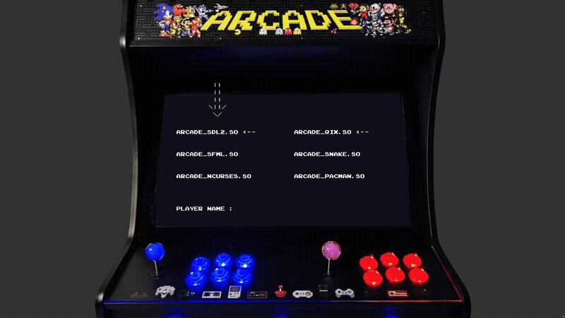
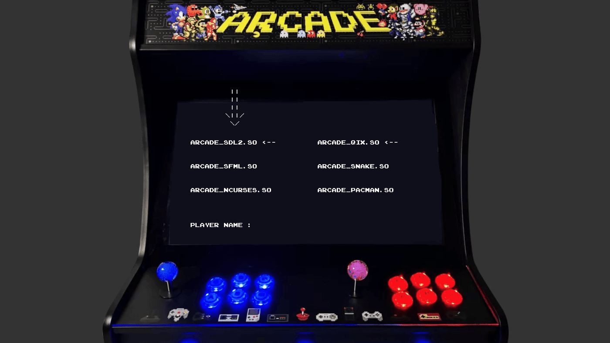

<div align="center">

# Arcade

**Une borne d'arcade où les jeux et le rendu graphique se changent à chaud.**

    

<sub>Projet à 3 · 2024</sub>

</div>

<br/>

<p align="center"></p>

## Le projet en quelques mots

Une plateforme de jeux en C++ où **tout est un plugin**. Les jeux (Snake, Pac-Man, Qix) et les moteurs de rendu (SFML, SDL2, ncurses) sont des bibliothèques dynamiques chargées à l'exécution. On peut passer de Pac-Man en SFML à Pac-Man dans le terminal sans relancer le programme.

## Ce que ça fait

- **3 bibliothèques graphiques** interchangeables à chaud : SFML, SDL2, ncurses
- **Jeux** : Snake, Pac-Man et Qix, plus un menu de sélection avec pseudo
- Sauvegarde des meilleurs scores par joueur
- Interfaces `IGameModule` / `IDisplayModule` partagées avec un autre groupe : leurs jeux tournent sur notre cœur, et inversement
- Documentation complète pour ajouter un jeu ou une bibliothèque : [DOCUMENTATION.md](DOCUMENTATION.md)

<p align="center"></p>
<p align="center"><sub>Le menu : choix de la bibliothèque graphique, du jeu et du pseudo</sub></p>

## Lancer le projet

```bash
make
./arcade ./lib/arcade_sfml.so      # ou arcade_sdl2.so / arcade_ncurses.so
# menu : flèches pour choisir, taper son pseudo, Entrée pour jouer
```

La documentation technique complète est dans [DOCUMENTATION.md](DOCUMENTATION.md).

## L'équipe

<a href="https://github.com/Wilson-Epitech/arcade/graphs/contributors"></a>

Mathis Brehm, Wilson Bordichon, Bradley Malbrouck

**Ma partition :** J'ai écrit la **documentation technique** du projet (fonctionnement du cœur, interfaces, ajout d'un jeu ou d'une bibliothèque), le **système de sauvegarde des scores** et la structure des jeux.
